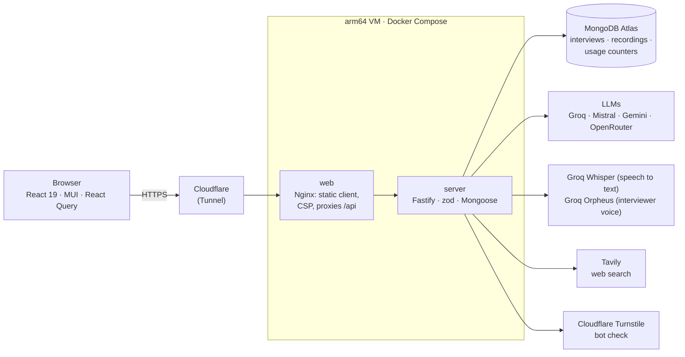

# AI Interviewer

[](https://github.com/mnp-gh/ai-interviewer/actions/workflows/deploy.yml)

Practise a job interview with an AI interviewer tailored to your resume and the job you want, out loud or typed, and get honest coaching on every answer.

**Try it: [ai-interviewer.mnplabs.uk](https://ai-interviewer.mnplabs.uk)**. No sign-up; "Try a sample" fills in a resume and job description if you don't have one handy.

<!-- screenshots -->

## What it does

1. **Setup.** Upload your resume (PDF or text) and paste the job description. The AI extracts your **candidate profile** and the **role requirements**, which you review and edit, shows how you **match**, and researches the company and role on the web for a **role briefing** with sources. Pick the interview type, difficulty, length, mode, voice and interviewer model.
2. **Interview.** Questions stream in, tailored to you, the role and your earlier answers; about a third draw on the role briefing.
   - **Coach mode:** feedback after each answer, and you can ask the coach about it or try the question again.
   - **Mock mode:** like the real thing, with feedback only in the report.
   - **Spoken voice:** the interviewer reads each question aloud, and you answer out loud. Your recording is transcribed for you to check and correct, and **how you said it** (pace, filler words, pauses, confidence) is judged apart from what you said. Any single answer can still be typed.
3. **Report.** An overall score, a score and note for each question, what a strong answer would have included, strengths, and what to work on next. A spoken interview adds a separate delivery score, and each spoken answer can be replayed.
4. **History.** Reopen a report, resume an interview, practise again with the same setup, or delete. Save your history with a **passkey** or a **recovery code** to open it in another browser or after clearing your browsing data.

No sign-up and no email: each browser gets an anonymous id. Everything runs on free AI tiers (Groq by default, optionally Mistral, Gemini and OpenRouter), protected by a bot check and usage budgets.

## Architecture



```
client/   React 19 + Vite + MUI, React Query, React Router
server/   Fastify API (TypeScript), Mongoose (MongoDB Atlas), OpenAI-compatible SDK for every AI provider
deploy/   Dockerfile, Compose file and the web container's Nginx config
```

- **One origin.** In production the web container serves the static client and proxies the API under `/api`; locally Vite proxies `/api` to the server on port 8080. No CORS, and no API URL in the client.
- **One document per interview** (setup, turns, report) in MongoDB, with recordings in their own collection.
- **Streaming** as NDJSON over POST for questions, feedback and coach replies.
- **Types shared** by importing the server's zod schemas type-only from the client.

| Path | What's there |
|---|---|
| `server/src/interview/` | Domain schemas, prompts, the interview service, the Mongo models, delivery metrics, recordings |
| `server/src/ai/` | Model registry (the one file to edit when free models change, speech models included), the AI client and the speech client |
| `server/src/research/` | Web search (Tavily) and role briefings |
| `server/src/usage/meter.ts` | Usage budgets and caps |
| `server/src/http/` | Candidate id, bot check, security headers, errors, NDJSON streaming |
| `client/src/pages/` | Home and history, setup wizard, interview room, report, admin usage |
| `client/src/voice/` | Recording, the microphone check, the interviewer's voice and browser dictation |

## Engineering highlights

- **No duplicate turns, without transactions.** A double click, a refresh mid-stream and a retry all race to add the next question. The service reserves the slot with one conditional update (`$push` only while `turns` still has the expected `$size`), writes an answer only while its slot is empty, reclaims a slot whose request died, and releases it with `$pop` if generation fails. The guards use `$type` rather than `null`, because on an array path Mongo also matches `turns.3` as a field on every element ([service](server/src/interview/service.ts), [ADR 0002](docs/adr/0002-one-document-per-interview.md)).
- **A free, anonymous service that can't be run dry.** No accounts, so abuse is bounded in layers: a single-use Turnstile token for new work; daily AI-token budgets per candidate and per IP (an IPv6 /64 counts as one); a per-minute call limit; and global daily caps set under each provider's free quota, including audio seconds and the voice model's characters. Each call checks the budget just before it runs and records the tokens the provider reports. The worst case is "out of free capacity for today", never a bill ([meter](server/src/usage/meter.ts), [ADR 0007](docs/adr/0007-usage-budgets-and-bot-check-instead-of-sign-in.md)).
- **Streaming that survives a disconnect.** Replies stream as NDJSON over POST, which works with request bodies and plain proxies (unlike `EventSource`). The stream opens on the first event, so early failures are still ordinary HTTP errors; if the browser goes away, generation finishes and is saved, so a refresh shows the whole question ([ADR 0009](docs/adr/0009-ndjson-streaming-over-post.md)).
- **Judging how an answer was said, not just what.** Spoken answers go to Groq Whisper with word timestamps (and a prompt written in filler words, so it keeps the "um"s). Pace, filler words and pauses come from the timings of the *uncorrected* transcript; content is scored from the text the candidate corrected, so a misheard technical term isn't penalised ([delivery](server/src/interview/delivery.ts), [ADR 0011](docs/adr/0011-spoken-answers-transcribed-on-the-server-recordings-in-their-own-collection.md)).
- **Recordings you can seek.** `MediaRecorder` writes WebM as a live stream with no duration, so players can't seek. The server writes the EBML `Duration` element into the file as it serves it, and answers HTTP Range requests ([webm](server/src/interview/webm.ts)).
- **A voice that degrades gracefully.** Questions are read by Groq's Orpheus within its small free quota; once a cap is reached, or a request fails, the browser's best installed voice takes over for the rest of the visit, ranked to prefer neural voices and to skip novelty ones ([interviewerVoice](client/src/voice/interviewerVoice.ts)).
- **The coach can't leak into the score.** Feedback and coach chat come from a separate role; the interviewer's prompts hold only questions and answers, and the report scores only answers ([ADR 0005](docs/adr/0005-coach-kept-apart-from-interviewer.md)).
- **Web research treated as untrusted.** Search results are fenced as data in the prompt, points citing unknown sources are dropped, and links only ever come from the search results, never from the model ([ADR 0006](docs/adr/0006-role-briefing-from-web-search.md)).
- **One source of truth for types.** The client imports API types from the server's zod schemas, type-only, with no shared package or code generation ([ADR 0008](docs/adr/0008-client-types-come-from-server-schemas.md)).
- **Tests that never touch a provider.** The server's tests run against a scripted fake AI and fake speech client with an in-memory MongoDB, so they're fast, free and deterministic.

## Trade-offs and what's next

| Chose | Over | Because | Revisit when |
|---|---|---|---|
| Anonymous ids, passkeys or recovery codes | Email or social sign-in | Zero friction and no personal details | Someone with many IPs keeps exhausting the global caps |
| One VM with Docker | Serverless (Workers, Render free) | A long-lived Mongo pool, no cold starts, no time limit on streams or PDF parsing | Traffic outgrows one small VM |
| Recordings in MongoDB | Object storage | One store to back up and keep in step with interviews | Recordings near the free 0.5 GB; move them to R2 or S3 |
| Free models across providers | One paid model | Costs nothing; a fallback when one quota runs out | Quality or rate limits matter more than cost |
| Plain PDF text extraction | A vision model reading the page | Free and instant | Many resumes use multi-column or scanned layouts |

Next on the list: requiring sign-in only if abuse appears, moving recordings to object storage, and a vision pass for multi-column PDFs.

## Getting started

Requires **Node 24+** and **pnpm 10**. With nvm: `nvm use` (reads `.nvmrc`), then `corepack enable` so `pnpm` is the pinned version. `pnpm` refuses to run on older Node (`engine-strict`); to make 24 your default, `nvm alias default 24`.

```sh
pnpm install
cp server/.env.example server/.env   # fill in MONGODB_URI and GROQ_API_KEY at minimum
cp client/.env.example client/.env   # optional: Turnstile site key
pnpm dev                             # http://localhost:5173 (API on :8080)
```

Optional keys in `server/.env` switch features on: `MISTRAL_API_KEY`, `GEMINI_API_KEY`, `OPENROUTER_API_KEY` (more models), `TAVILY_API_KEY` (role briefing), `TURNSTILE_SECRET_KEY` (bot check), `ADMIN_TOKEN` (the `/admin` usage page). `server/.env.example` documents every variable, including the usage budgets. Environment files are read at startup, so restart `pnpm dev` after editing them.

| Command | Does |
|---|---|
| `pnpm dev` | Client and server with reload |
| `pnpm test` | Server tests (fake AI, in-memory MongoDB) and client tests (jsdom) |
| `pnpm typecheck` / `pnpm lint` / `pnpm build` | Across both packages |

Tests never call real AI providers. The first server test run downloads a MongoDB binary for the in-memory database.

## Deploying

`deploy/docker-compose.yml` runs two containers, built from `deploy/Dockerfile` on [Docker Hardened Images](https://docs.docker.com/dhi/) (non-root, no shell): the API (`server`) and Nginx (`web`, configured by `deploy/web.conf`), which serves the built client, sets the Content Security Policy and security headers, and proxies `/api` to the API. Only `web` publishes a port, and only on `127.0.0.1:8081`. A [Cloudflare Tunnel](https://developers.cloudflare.com/cloudflare-one/connections/connect-networks/) on the VM forwards the site's hostname to it, so Cloudflare terminates HTTPS, the VM opens no inbound ports, and the site and API share one origin.

The server holds only what each deploy writes:

```
~/ai-interviewer/
  deploy/docker-compose.yml   copied by each deploy
  deploy/.env                 SITE_ADDRESS and IMAGE_REPO, written by each deploy
  server/.env                 the server's variables, written by each deploy
```

One-time setup on an arm64 VM with Docker Compose, `jq` and `curl`:

1. **Add a self-hosted runner** (Settings → Actions → Runners → New self-hosted runner, Linux ARM64) and run it as a service, as a user in the `docker` group. The deploy job runs on the labels `self-hosted, linux, arm64`.
2. **Add a Cloudflare Tunnel** for the site's hostname, pointing at `http://127.0.0.1:8081`, and add the hostname to the Turnstile widget.
3. **Set the configuration** in GitHub (below) and push to `main`, or run the workflow by hand (Actions → CI/CD → Run workflow). `docker compose logs -f` in `~/ai-interviewer/deploy` shows the logs.

Without CI, `docker login dhi.io` (a Docker Hub account) and then `docker compose up -d --build` in `deploy/`, with `deploy/.env` (see `deploy/.env.example`) and `server/.env`, builds and starts the same containers.

Server variables:

| Variable | Required | Notes |
|---|---|---|
| `MONGODB_URI` | yes | Atlas connection string |
| `GROQ_API_KEY` | yes | Default and parsing model, speech to text, interviewer voice |
| `TURNSTILE_SECRET_KEY` | recommended | Bot check; pair it with `VITE_TURNSTILE_SITE_KEY` |
| `TAVILY_API_KEY` | optional | Role briefing |
| `MISTRAL_API_KEY`, `GEMINI_API_KEY`, `OPENROUTER_API_KEY` | optional | More models |
| `ADMIN_TOKEN` | optional | Turns on the `/admin` usage page |
| `DAILY_TOKENS`, `DAILY_AUDIO_SECONDS`, ... | optional | Budgets; defaults in `server/.env.example` |

**Before inviting users**, work through the release checklist in [docs/security.md](docs/security.md).

Also:

- **Atlas network access.** Allow only the VM's public egress IP (keep it fixed) instead of `0.0.0.0/0`.
- **Passkeys belong to `SITE_ADDRESS`.** Passkeys saved on another domain don't work there; recovery codes do. Pick the name once.
- **Sharing the server with other apps.** This app owns the Compose project `ai-interviewer` and host port `127.0.0.1:8081`, and deploys only remove its own images. Another app needs its own port and tunnel hostname.
- **Only localhost reaches the containers.** The API trusts the `CF-Connecting-IP` header Cloudflare sets, so keep port 8081 bound to `127.0.0.1` and never publish 8080.

### Continuous deployment

`.github/workflows/deploy.yml` lints, typechecks and tests every push and pull request. On `main` it then builds both images on a GitHub-hosted arm64 runner and pushes them to GHCR tagged with the commit; the self-hosted runner on the VM writes the configuration, pulls the images, restarts and waits for a health check. To roll back, rerun an older run's **deploy** job: it deploys that commit's images.

All configuration lives in GitHub. Each deploy writes `server/.env` from the `production` environment (Settings → Environments → production), so to change a setting, edit it there and run the workflow.

| Kind | Name | Value |
|---|---|---|
| Environment variable | `SITE_ADDRESS` | The site's hostname, e.g. `ai-interviewer.mnplabs.uk`; passkeys belong to it |
| Environment secrets and variables | Every server variable (`MONGODB_URI`, `GROQ_API_KEY`, `DAILY_TOKENS`, ...) | Copied to `server/.env` as they are: secrets for keys, variables for plain settings. A new one needs no workflow change |
| Repository secrets | `DHI_USERNAME`, `DHI_TOKEN` | A Docker Hub username and read-only access token, for pulling the Docker Hardened base images |
| Repository variable | `VITE_TURNSTILE_SITE_KEY` | The Turnstile site key; public, and read when the image is built |

To set many at once, put them in `.env.production` at the repo root (git-ignored, `server/.env` syntax) and run `deploy/github-config.sh`: it makes keys secrets, plain settings variables, `DHI_*` repository secrets and `VITE_*` repository variables.

Names starting with `DEPLOY_`, `DHI_` or `VITE_` stay out of `server/.env`. Values must fit on one line.

## Documentation

- [Decisions](docs/decisions.md): every product and technical decision, and why
- [Decision records](docs/adr/): the bigger, harder-to-reverse choices in more depth
- [Security](docs/security.md): abuse protection, known limits, and the release checklist
- [Glossary](GLOSSARY.md): the domain vocabulary used in code and docs
- [AGENTS.md](AGENTS.md): conventions for AI coding agents working in this repo
