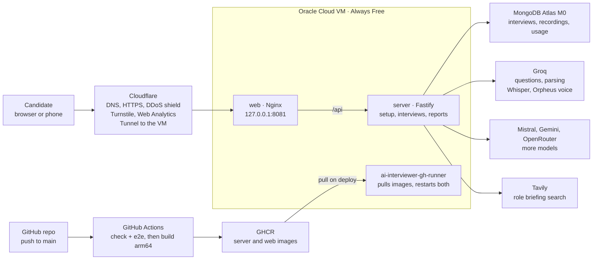

# Deployment: services and setup

The app is two containers on a free Oracle Cloud VM, reachable only through Cloudflare and redeployed from GitHub on every push to `main`. Everything runs on free plans; the only recurring cost is the yearly renewal of `mnplabs.uk`, shared with the portfolio.

As of November 2026.

## Overview

Requests pass through Cloudflare's tunnel to the web container, which serves the client and forwards `/api` to the server. The server calls MongoDB, the AI providers and Tavily. Deploys run the other way: GitHub builds the images, and the runner on the VM pulls them.

## Services

| Service | What it does for the app | Plan | Cost |
| --- | --- | --- | --- |
| Oracle Cloud VM (arm64) | Runs the web and server containers with Docker Compose, shared with the portfolio | Always Free | Free |
| Cloudflare Registrar | Owns the domain `mnplabs.uk` | At-cost registrar | Yearly renewal |
| Cloudflare DNS + HTTPS | Serves `ai-interviewer.mnplabs.uk`, terminates HTTPS, absorbs network floods | Free | Free |
| Cloudflare Tunnel | Forwards `ai-interviewer.mnplabs.uk` to `127.0.0.1:8081` on the VM; the VM opens no inbound ports | Free | Free |
| [Cloudflare Turnstile](https://developers.cloudflare.com/turnstile/plans/) | Bot check on each setup step, starting an interview and restoring a history | Free | Free, unlimited checks |
| Cloudflare Web Analytics | Visits, pages, referrers and countries, in aggregate | Free | Free |
| GitHub repo `mnp-gh/ai-interviewer` | Source code | Free | Free |
| GitHub Actions | CI/CD (check, e2e, build, deploy), CodeQL, uptime check every 30 minutes, Dependabot | Free | Free within the monthly allowance |
| GitHub Container Registry (GHCR) | Stores the server and web images each deploy pulls | Free | Free within the storage allowance |
| Self-hosted runner `ai-interviewer-gh-runner` | Runs the deploy job on the VM | Free | Free |
| Docker Hardened Images (`dhi.io`) | Non-root, shell-less Node and Nginx base images, pulled with your Docker Hub account | Your Docker Hub account | No new cost |
| [MongoDB Atlas](https://www.mongodb.com/pricing) | Stores interviews, spoken-answer recordings, saved histories and usage counters | M0 | Free, 512 MB |
| [Groq](https://console.groq.com/docs/rate-limits) | **Required.** Default interviewer models, resume and job parsing, Whisper speech to text, Orpheus interviewer voice | Free | Free, within daily per-model limits |
| [Mistral](https://mistral.ai/pricing) | Optional: Mistral Small | Free (Experiment) | Free; may train on inputs |
| [Google Gemini API](https://ai.google.dev/gemini-api/docs/pricing) | Optional: Gemini Flash-Lite | Free | Free; may train on inputs |
| [OpenRouter](https://openrouter.ai/models?q=free) | Optional: free Nemotron and Gemma models | Free models | Free, low daily limit |
| [Tavily](https://www.tavily.com/#pricing) | Optional: web search for the role briefing | Free | Free, about 1,000 searches a month |
| Google Fonts | Serves the app's web fonts | Free | Free |

Without an optional key the app still works: its models aren't offered, or the setup skips the role briefing.

## Configuration

All settings live in GitHub; each deploy writes them onto the VM, so nothing is edited on the server by hand.

| Name | Kind | Where in GitHub | Read by | Value or note |
| --- | --- | --- | --- | --- |
| `DHI_USERNAME`, `DHI_TOKEN` | Secret | Repository | Build job | Docker Hub account + read-only token |
| `VITE_TURNSTILE_SITE_KEY` | Variable | Repository | Web image build | Public Turnstile site key |
| `SITE_ADDRESS` | Variable | `production` environment | Compose file | `ai-interviewer.mnplabs.uk`; passkeys belong to it, so never change it |
| `MONGODB_URI` | Secret | `production` environment | API | Atlas connection string |
| `GROQ_API_KEY` | Secret | `production` environment | API | Required |
| `MISTRAL_API_KEY`, `GEMINI_API_KEY`, `OPENROUTER_API_KEY` | Secret | `production` environment | API | Optional, more models |
| `TAVILY_API_KEY` | Secret | `production` environment | API | Optional, role briefing |
| `TURNSTILE_SECRET_KEY` | Secret | `production` environment | API | Verifies Turnstile tokens |
| `ADMIN_TOKEN` | Secret | `production` environment | API | Unlocks `/admin`; 32+ characters |

Not set, so the defaults in `server/.env.example` apply: the usage budgets (`DAILY_TOKENS`, `DAILY_AUDIO_SECONDS`, `DAILY_VOICE_QUESTIONS`, ...), `PARSE_MODEL` and `MAINTENANCE_MODE`. The Compose file sets `PUBLIC_ORIGIN` and `CLIENT_IP_HEADER` itself.

Left over from the old SSH deploy and unused, safe to delete: the `AI_MODEL` and `DEPLOY_KNOWN_HOSTS` secrets and the `DEPLOY_PATH` variable in `production`.

On the VM, a deploy writes:

- `SITE_ADDRESS` and the image names to `~/ai-interviewer/deploy/.env`;
- every other `production` secret and variable to `~/ai-interviewer/server/.env` (names starting `DEPLOY_`, `DHI_` or `VITE_` are skipped).

A new server variable needs no workflow change: add it to `production` and run the workflow. To set many at once, put them in `.env.production` at the repo root (git-ignored) and run `deploy/github-config.sh`.

## How a deploy works

Every push to `main` deploys automatically; pull requests only run the checks.

1. **check** (GitHub-hosted runner): lints, typechecks, runs the server tests against an in-memory MongoDB and the client tests.
2. **e2e** (GitHub-hosted runner): a browser runs a whole interview against the real server, with scripted AI.
3. **build** (GitHub-hosted arm64 runner): builds the server and web images from `deploy/Dockerfile` and pushes them to GHCR, tagged with the commit.
4. **deploy** (`ai-interviewer-gh-runner` on the VM): writes the settings, pulls the images, restarts Docker Compose project `ai-interviewer`, then waits for `/api/health`.

| Runner on the VM | Repository | Folder | Service |
| --- | --- | --- | --- |
| `ai-interviewer-gh-runner` | `mnp-gh/ai-interviewer` | `~/actions-runner` | `actions.runner.mnp-gh-ai-interviewer.ai-interviewer-gh-runner` |
| `portfolio-gh-runner` | `mnp-gh/portfolio` | `~/actions-runner-portfolio` | `actions.runner.mnp-gh-portfolio.portfolio-gh-runner` |

- **Deploy by hand:** Actions → CI/CD → Run workflow, or `gh workflow run deploy.yml -R mnp-gh/ai-interviewer`.
- **Roll back:** re-run an older run's **deploy** job; it redeploys that commit's images.
- **Logs:** on the VM, `cd ~/ai-interviewer/deploy && docker compose logs -f`.
- **Ports:** this app owns `127.0.0.1:8081`, the portfolio `127.0.0.1:8082`. Keep 8081 bound to localhost: the API trusts the `CF-Connecting-IP` header, so only the tunnel may reach it.

## Operating it

Day to day, everything is done from GitHub, Cloudflare or the app itself; the VM needs no attention.

| Task | How |
| --- | --- |
| Change a setting or budget | Edit it in GitHub (Configuration above), then run the workflow |
| See today's usage | `ai-interviewer.mnplabs.uk/admin` with `ADMIN_TOKEN`: tokens, searches, audio and voice against their budgets |
| Pause new interviews | Set `MAINTENANCE_MODE=true` in `production` and run the workflow; interviews in progress can finish |
| See overall traffic | Cloudflare → Analytics & Logs → Web Analytics |
| Get alerted when the site is down | The Uptime workflow emails you when `/api/health` fails |
| Keep dependencies current | Review and merge Dependabot's weekly pull requests |
| Swap a retired free model | Edit `server/src/ai/models.ts`, the one file that lists every model |
| Keep the domain | Keep the `mnplabs.uk` renewal active in Cloudflare Registrar |

Free-tier limits that matter, and what keeps the app under them:

| Service | Limit | What keeps you under it |
| --- | --- | --- |
| Groq models | Per-model daily token limits | `DAILY_TOKENS` (1.5 million a day across everyone), plus per-candidate and per-IP caps |
| Groq Whisper | 28,800 audio seconds a day | `DAILY_AUDIO_SECONDS` (25,200), 2-minute recordings |
| Groq Orpheus voice | 100 requests and a few thousand characters a day | `DAILY_VOICE_QUESTIONS` (90) and `DAILY_VOICE_CHARACTERS`; past them the browser's voice reads |
| Tavily | About 1,000 searches a month | `DAILY_SEARCHES` (30 a day) |
| MongoDB Atlas M0 | 512 MB storage | New recordings stop being kept past `RECORDING_STORAGE_MB` (350); answers are still judged |
| Cloudflare Turnstile | 20 widgets, 10 hostnames each | One widget in use |

## Sources

- [Groq rate limits](https://console.groq.com/docs/rate-limits)
- [Tavily pricing](https://www.tavily.com/#pricing)
- [MongoDB Atlas pricing](https://www.mongodb.com/pricing)
- [Cloudflare Turnstile plans](https://developers.cloudflare.com/turnstile/plans/)
- [Cloudflare Tunnel](https://developers.cloudflare.com/cloudflare-one/connections/connect-networks/)
